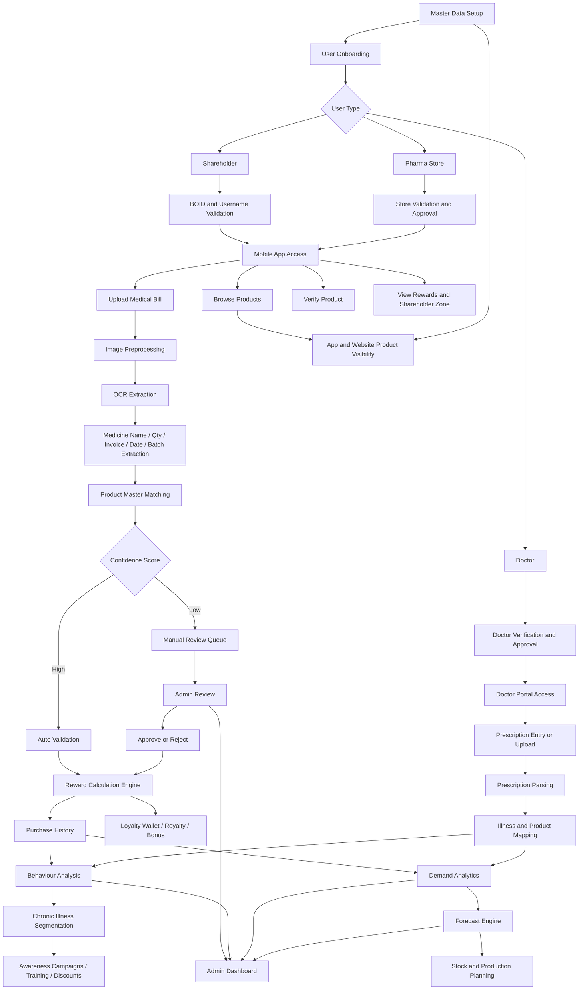
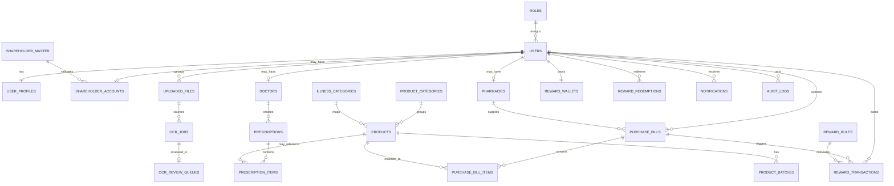

# OM Connect — Project Overview

## Overview

OM Connect is a pharma loyalty, shareholder engagement, OCR intelligence, and demand-forecasting platform composed of four connected products: a backend admin panel, company website, iOS app, and Android app. The first launch is intended for shareholders and pharma stores, with BOID validation, purchase upload, OCR-based bill extraction, reward calculation, and product visibility across app and website as the highest-priority capabilities.

The platform is designed to convert medical bills and prescriptions into structured data — medicine name, quantity, invoice date, batch number, pharmacy source, and user purchase history — then use that data for loyalty rewards, behaviour tracking, chronic illness awareness campaigns, pharmacy intelligence, and future stock forecasting. The attached mockup also suggests core app areas such as purchase entry, product verification, rewards, company profile, shareholder zone, and product-linked engagement flows.

---

## Complete Workflow Diagram

### End-to-End Flow

### Functional Workflow Layers

1. **Foundation Layer** — Product master, shareholder master, BOID master, pharmacy master, doctor master, role rules, reward rules.
2. **Transaction Layer** — Signup, validation, bill upload, OCR extraction, prescription capture, reward processing, notifications.
3. **Intelligence Layer** — Purchase behaviour analysis, disease-category clustering, doctor trend analysis, demand prediction, stock planning.
4. **Action Layer** — Discounts, campaigns, awareness programs, shareholder engagement, sourcing visibility, management decisions.

---

## Module-Wise BRD / SRS

### Product Scope

The solution shall be delivered as one integrated platform with a shared backend and separate role-based interfaces for admin, website visitors, app users, pharma stores, shareholders, and doctors. The product catalog must be managed centrally so any approved product appears consistently on the website and the mobile applications.

---

### Module 1: Identity, Onboarding, and Access Control

#### Business Requirement

The system must support initial onboarding for shareholders and pharma stores, as these are the first target users for launch. BOID and username validation must happen from backend master records so unauthorized or invalid users cannot access restricted areas or claim benefits.

#### Functional Requirements

- User registration by role: shareholder, pharma store, doctor, admin.
- BOID validation against stored backend master list for shareholder users.
- Username uniqueness check and mobile/email verification.
- Approval workflow for pharmacy and doctor accounts.
- Role-based access control for admin panel, doctor module, shareholder zone, and store tools.

#### Non-Functional Requirements

- Secure authentication with audit logging.
- Scalable onboarding flow to support phased rollout.
- Validation response time should feel near-real-time to users.

#### Key Outputs

- Approved user profile
- Role assignment
- Validation status
- Login credentials / token session

---

### Module 2: Product Catalog and Company Website

#### Business Requirement

The pharma company needs to list products centrally, and those products should be visible in the app as well as the website. The website should also support company profile, product information, promotional content, and possibly doctor/pharmacy awareness content aligned with the mobile app structure shown in the mockup.

#### Functional Requirements

- Product CRUD in admin panel.
- Product fields: brand, generic name, dosage form, strength, pack size, image, MRP, status, availability, therapeutic category.
- Product sync API for website and mobile apps.
- Product verification feature in app.
- Search, category filter, and product detail pages.

#### Non-Functional Requirements

- Centralized content consistency across channels.
- Fast product retrieval for app browsing.

#### Key Outputs

- Product listings on website
- Product listings in app
- Product verification records

---

### Module 3: Purchase Upload and OCR Engine

#### Business Requirement

The app must allow users to upload medical bills, and the system must extract medicine details and quantities from those bills, as OCR is the core of the project. The extracted information is required for reward logic, behaviour tracking, chronic illness insight, and downstream analytics.

#### Functional Requirements

- Bill image upload from mobile app.
- Image preprocessing: crop, rotate, denoise, contrast correction.
- OCR text extraction from invoice or bill image.
- Entity extraction for medicine name, quantity, invoice number, purchase date, batch number, store details, total amount, and line items where available.
- Confidence scoring and low-confidence manual review queue.
- Duplicate bill detection and fraud checks.
- Mapping of OCR medicine text to internal product master and medicine master.

#### Non-Functional Requirements

- OCR service must support noisy and semi-structured bill formats.
- Extraction pipeline must log raw text, parsed text, and confidence values for auditability.
- Sensitive uploads should be access-controlled and retained under privacy rules.

#### Key Outputs

- OCR raw text
- Parsed bill header
- Parsed bill line items
- Validation score
- Approval / rejection status

---

### Module 4: Loyalty, Royalty, and Offer Engine

#### Business Requirement

Users should earn royalty, points, or bonus based on purchases so the app becomes a loyalty platform that drives repeat engagement and promotion. The project also intends to support shareholder-focused incentives and offer mechanics linked to verified transactions.

#### Functional Requirements

- Reward rules by product, quantity, amount, campaign, user type, and date window.
- Royalty / bonus calculation after bill approval.
- Wallet or points ledger for each user.
- Reward redemption workflow and transaction history.
- Admin controls for campaigns, thresholds, and exceptions.

#### Non-Functional Requirements

- Every reward transaction must be auditable.
- Calculations must be deterministic and repeatable.

#### Key Outputs

- Points earned
- Bonus / royalty credited
- Offer eligibility
- Reward statements

---

### Module 5: Shareholder Zone

#### Business Requirement

The app is intended mainly for internal shareholder promotion and tracking, so shareholder features are a primary business objective rather than an optional add-on. The mockup shows a shareholder zone with dividend notices, AGM updates, financial reports, and special shareholder rewards.

#### Functional Requirements

- Shareholder profile linked to BOID.
- Dividend notices and AGM updates.
- Financial report publishing.
- Shareholder-exclusive offers and rewards.
- Internal announcements and notification feed.

#### Non-Functional Requirements

- Secure access to shareholder-only content.
- Traceable publish history for compliance-sensitive notices.

#### Key Outputs

- Shareholder dashboard
- Notice archive
- Rewards and engagement metrics

---

### Module 6: Pharmacy / Store Operations

#### Business Requirement

Pharma stores are part of the first launch group and also need features around sourcing details, purchase date, and other operational data. Store-level records help validate transaction authenticity and improve supply-side analytics.

#### Functional Requirements

- Pharmacy account onboarding and approval.
- Store profile with license and sourcing metadata.
- Record of purchases, sourcing dates, supplier details, stock-related inputs, and invoice history.
- Store-level dashboard showing reward claims, submitted bills, approved entries, and product movement.

#### Non-Functional Requirements

- Strong traceability for transaction-source validation.
- Role-based limits so stores only see their own data.

#### Key Outputs

- Store profile
- Sourcing records
- Purchase and claim history

---

### Module 7: Doctor and Prescription Module

#### Business Requirement

Doctors should be able to add prescriptions so the company can understand which illnesses and prescription trends are most common, which can later support research and development decisions. This module helps identify disease patterns and product usage by prescription stream, not only by purchase stream.

#### Functional Requirements

- Doctor registration and verification.
- Prescription entry via form or document upload.
- Prescription parsing and mapping to product / generic / therapy area.
- Patient category tagging without exposing more data than necessary.
- Analytics on illness category, prescription frequency, and product preference.

#### Non-Functional Requirements

- Strict privacy and access control for medical data.
- Structured logging for research-oriented analysis.

#### Key Outputs

- Prescription records
- Illness mapping
- Doctor trend summaries

---

### Module 8: Behaviour, Illness, and Awareness Intelligence

#### Business Requirement

The company wants to understand purchasing behaviour and identify users who may have long-term illness patterns — such as diabetes or hypertension — then use that insight to provide help, training, discounts, and awareness programs. The system must transform repeated medicine purchases into interpretable patient-support segments while remaining careful about confidence and privacy.

#### Functional Requirements

- Repeat purchase tracking by user and product.
- Therapy-area grouping of products and molecules.
- Chronic illness likelihood rules based on repeated medicine classes and prescription history.
- Segment creation for campaigns: diabetes awareness, hypertension training, long-term care discounts, patient education.
- Campaign performance reporting.

#### Non-Functional Requirements

- Inference engine must keep explainable logic and confidence labels.
- Segment access must be restricted as it deals with sensitive health-adjacent data.

#### Key Outputs

- Behaviour segments
- Illness indicators
- Awareness audience lists
- Campaign response analytics

---

### Module 9: Forecasting and Decision Support

#### Business Requirement

The product should eventually become smart enough to predict and forecast future stock quantity based on demand growth so production can be planned accordingly. This module depends on trusted OCR transactions, store records, product movement, and prescription trends as upstream data sources.

#### Functional Requirements

- Historical demand aggregation by product, region, store, and period.
- Trend analysis using purchases, approved bills, and prescriptions.
- Forecast model for stock quantity recommendation.
- Alerts for probable stock pressure or high-growth SKUs.
- Admin dashboard with scenario comparison and forecast-vs-actual review.

#### Non-Functional Requirements

- Forecast logic should support versioning and retraining.
- Dashboards should expose assumptions clearly for management use.

#### Key Outputs

- Forecast snapshots
- Product demand trends
- Suggested production quantities
- Forecast accuracy reports

---

## Database Schema

### Schema Approach

A relational database with audit tables is the right fit for the transactional core, as the platform needs strong validation, role-based control, reward traceability, and analytics-ready history. OCR raw output and file metadata can be stored alongside normalized entities, while forecasting features can be prepared from warehouse-style aggregate tables derived from operational tables.

### Core Entities

#### 1. Users and Access

**users**

| Column | Type | Notes |
|--------|------|-------|
| id | bigint | Primary key |
| name | varchar(255) | |
| email | varchar(255) | Unique |
| mobile | varchar(20) | |
| workos_id | varchar(255) | WorkOS auth identifier |
| avatar | varchar(255) | |
| status | varchar(20) | active, inactive, suspended |
| email_verified_at | timestamp | |
| created_at | timestamp | |
| updated_at | timestamp | |

**roles**

| Column | Type | Notes |
|--------|------|-------|
| id | bigint | Primary key |
| name | varchar(255) | admin, shareholder, pharmacy, doctor, staff |

**user_has_roles**

| Column | Type | Notes |
|--------|------|-------|
| user_id | bigint | FK → users |
| role_id | bigint | FK → roles |

**user_profiles**

| Column | Type | Notes |
|--------|------|-------|
| id | bigint | Primary key |
| user_id | bigint | FK → users |
| gender | varchar(20) | |
| dob | date | |
| address | text | |
| province | varchar(100) | |
| district | varchar(100) | |

#### 2. Shareholder and BOID

**shareholder_master**

| Column | Type | Notes |
|--------|------|-------|
| id | bigint | Primary key |
| boid | varchar(50) | Unique beneficiary owner ID |
| shareholder_name | varchar(255) | |
| mobile | varchar(20) | |
| email | varchar(255) | |
| status | varchar(20) | active, inactive |
| source_note | text | |

**shareholder_accounts**

| Column | Type | Notes |
|--------|------|-------|
| id | bigint | Primary key |
| user_id | bigint | FK → users |
| shareholder_master_id | bigint | FK → shareholder_master |
| boid | varchar(50) | |
| shares_owned | decimal | |
| verification_status | varchar(20) | |
| verified_at | timestamp | |

**boid_validation_logs**

| Column | Type | Notes |
|--------|------|-------|
| id | bigint | Primary key |
| boid | varchar(50) | |
| requested_by_user_id | bigint | FK → users |
| result | varchar(50) | |
| message | text | |
| created_at | timestamp | |

#### 3. Pharmacy / Store Domain

**pharmacies**

| Column | Type | Notes |
|--------|------|-------|
| id | bigint | Primary key |
| user_id | bigint | FK → users |
| store_name | varchar(255) | |
| license_no | varchar(100) | |
| pan_vat_no | varchar(100) | |
| owner_name | varchar(255) | |
| district | varchar(100) | |
| address | text | |
| status | varchar(20) | active, inactive, suspended, pending |
| approved_at | timestamp | |

**pharmacy_sourcing_records**

| Column | Type | Notes |
|--------|------|-------|
| id | bigint | Primary key |
| pharmacy_id | bigint | FK → pharmacies |
| supplier_name | varchar(255) | |
| source_invoice_no | varchar(255) | |
| source_date | date | |
| notes | text | |
| created_at | timestamp | |

#### 4. Doctors and Prescriptions

**doctors**

| Column | Type | Notes |
|--------|------|-------|
| id | bigint | Primary key |
| user_id | bigint | FK → users |
| registration_no | varchar(100) | |
| specialty | varchar(255) | |
| hospital_clinic | varchar(255) | |
| status | varchar(20) | active, inactive, suspended, pending |
| approved_at | timestamp | |

**prescriptions**

| Column | Type | Notes |
|--------|------|-------|
| id | bigint | Primary key |
| doctor_id | bigint | FK → doctors |
| patient_ref_code | varchar(100) | |
| prescription_date | date | |
| source_type | varchar(50) | |
| uploaded_file_id | bigint | FK → uploaded_files |
| parsed_status | varchar(20) | pending, parsed, failed |
| confidence_score | decimal | |
| notes | text | |
| created_at | timestamp | |

**prescription_items**

| Column | Type | Notes |
|--------|------|-------|
| id | bigint | Primary key |
| prescription_id | bigint | FK → prescriptions |
| product_id | bigint | FK → products |
| medicine_name_raw | varchar(255) | |
| generic_name | varchar(255) | |
| dosage | varchar(100) | |
| quantity | decimal | |
| illness_category_id | bigint | FK → illness_categories |
| confidence_score | decimal | |

#### 5. Product and Medicine Master

**products**

| Column | Type | Notes |
|--------|------|-------|
| id | bigint | Primary key |
| sku | varchar(100) | |
| brand_name | varchar(255) | |
| generic_name | varchar(255) | |
| strength | varchar(100) | |
| dosage_form | varchar(100) | |
| pack_size | varchar(50) | |
| product_category_id | bigint | FK → product_categories |
| illness_category_id | bigint | FK → illness_categories |
| mrp | decimal(10,2) | |
| image | varchar(255) | |
| launch_status | varchar(50) | |
| is_active | boolean | |
| description | text | |

**product_categories**

| Column | Type | Notes |
|--------|------|-------|
| id | bigint | Primary key |
| name | varchar(255) | |
| description | text | |

**illness_categories**

| Column | Type | Notes |
|--------|------|-------|
| id | bigint | Primary key |
| name | varchar(255) | |
| description | text | |

**product_batches**

| Column | Type | Notes |
|--------|------|-------|
| id | bigint | Primary key |
| product_id | bigint | FK → products |
| batch_no | varchar(100) | |
| manufacture_date | date | |
| expiry_date | date | |
| status | varchar(20) | active, inactive, expired |

#### 6. Bill Upload and OCR

**uploaded_files**

| Column | Type | Notes |
|--------|------|-------|
| id | bigint | Primary key |
| user_id | bigint | FK → users |
| original_name | varchar(255) | |
| module_name | varchar(100) | purchase_bill, prescription, profile |
| file_type | varchar(50) | image, document, pdf |
| file_path | varchar(255) | Storage path |
| mime_type | varchar(100) | |
| file_size | bigint | In bytes |
| uploaded_at | timestamp | |

**purchase_bills**

| Column | Type | Notes |
|--------|------|-------|
| id | bigint | Primary key |
| user_id | bigint | FK → users |
| pharmacy_id | bigint | FK → pharmacies |
| uploaded_file_id | bigint | FK → uploaded_files |
| invoice_number | varchar(100) | |
| invoice_date | date | |
| subtotal_amount | decimal(10,2) | |
| tax_amount | decimal(10,2) | |
| total_amount | decimal(10,2) | |
| ocr_status | varchar(20) | pending, processing, completed, failed |
| validation_status | varchar(20) | |
| confidence_score | decimal(5,2) | |
| duplicate_flag | boolean | |
| fraud_flag | boolean | |
| created_at | timestamp | |

**purchase_bill_items**

| Column | Type | Notes |
|--------|------|-------|
| id | bigint | Primary key |
| purchase_bill_id | bigint | FK → purchase_bills |
| product_id | bigint | FK → products |
| product_name_raw | varchar(255) | |
| quantity | decimal | |
| unit_price | decimal(10,2) | |
| amount | decimal(10,2) | |
| batch_no | varchar(100) | |
| confidence_score | decimal(5,2) | |

**ocr_jobs**

| Column | Type | Notes |
|--------|------|-------|
| id | bigint | Primary key |
| module_name | varchar(100) | |
| source_file_id | bigint | FK → uploaded_files |
| status | varchar(20) | pending, processing, completed, failed |
| engine_name | varchar(100) | |
| raw_text | longtext | |
| parsed_json | json | |
| confidence_score | decimal(5,2) | |
| started_at | timestamp | |
| completed_at | timestamp | |

**ocr_review_queues**

| Column | Type | Notes |
|--------|------|-------|
| id | bigint | Primary key |
| ocr_job_id | bigint | FK → ocr_jobs |
| assigned_to | bigint | FK → users |
| review_status | varchar(20) | pending, approved, rejected |
| review_note | text | |
| reviewed_at | timestamp | |

#### 7. Rewards and Loyalty

**reward_rules**

| Column | Type | Notes |
|--------|------|-------|
| id | bigint | Primary key |
| name | varchar(255) | |
| user_type | varchar(50) | shareholder, pharmacy, doctor |
| basis_type | varchar(50) | qty, amount, hybrid |
| product_id | bigint | FK → products |
| illness_category_id | bigint | FK → illness_categories |
| min_qty | decimal | |
| min_amount | decimal(10,2) | |
| point_rate | decimal(10,2) | |
| bonus_type | varchar(50) | percentage, fixed |
| bonus_value | decimal(10,2) | |
| start_date | datetime | |
| end_date | datetime | |
| is_active | boolean | |

**reward_transactions**

| Column | Type | Notes |
|--------|------|-------|
| id | bigint | Primary key |
| user_id | bigint | FK → users |
| purchase_bill_id | bigint | FK → purchase_bills |
| reward_rule_id | bigint | FK → reward_rules |
| points_earned | decimal(10,2) | |
| bonus_amount | decimal(10,2) | |
| royalty_amount | decimal(10,2) | |
| transaction_type | varchar(50) | earned, redeemed, expired |
| status | varchar(20) | pending, completed, cancelled |
| created_at | timestamp | |

**reward_wallets**

| Column | Type | Notes |
|--------|------|-------|
| id | bigint | Primary key |
| user_id | bigint | FK → users |
| total_points | decimal(10,2) | |
| total_bonus | decimal(10,2) | |
| total_royalty | decimal(10,2) | |
| updated_at | timestamp | |

**reward_redemptions**

| Column | Type | Notes |
|--------|------|-------|
| id | bigint | Primary key |
| user_id | bigint | FK → users |
| redemption_type | varchar(50) | cashback, voucher, product |
| points_used | decimal(10,2) | |
| amount_value | decimal(10,2) | |
| status | varchar(20) | pending, approved, rejected, completed |
| requested_at | datetime | |
| approved_at | datetime | |

#### 8. Campaigns and Notices

**campaigns**

| Column | Type | Notes |
|--------|------|-------|
| id | bigint | Primary key |
| name | varchar(255) | |
| campaign_type | varchar(50) | promotion, awareness, product |
| target_segment | varchar(255) | |
| description | text | |
| start_date | datetime | |
| end_date | datetime | |
| status | varchar(20) | draft, active, completed, cancelled |

**campaign_recipients**

| Column | Type | Notes |
|--------|------|-------|
| id | bigint | Primary key |
| campaign_id | bigint | FK → campaigns |
| user_id | bigint | FK → users |
| illness_category_id | bigint | FK → illness_categories |
| sent_at | timestamp | |
| engagement_status | varchar(50) | |

**notices**

| Column | Type | Notes |
|--------|------|-------|
| id | bigint | Primary key |
| title | varchar(255) | |
| notice_type | varchar(50) | agm, financial, announcement, general |
| audience_type | varchar(50) | shareholder, pharmacy, doctor, all |
| body | longtext | |
| published_at | datetime | |
| status | varchar(20) | draft, published, archived |

**notifications**

| Column | Type | Notes |
|--------|------|-------|
| id | bigint | Primary key |
| user_id | bigint | FK → users |
| title | varchar(255) | |
| message | text | |
| channel | varchar(50) | email, sms, push |
| status | varchar(20) | sent, pending, failed |
| read_at | timestamp | |
| created_at | timestamp | |

#### 9. Admin, Content, and Audit

**audit_logs**

| Column | Type | Notes |
|--------|------|-------|
| id | bigint | Primary key |
| user_id | bigint | FK → users |
| module_name | varchar(100) | |
| action_name | varchar(50) | created, updated, deleted |
| entity_name | varchar(100) | |
| entity_id | bigint | |
| before_json | json | |
| after_json | json | |
| ip_address | varchar(45) | |
| created_at | timestamp | |

#### 10. Forecasting (Future)

The following tables are designed but not yet implemented in the current schema:

- **daily_product_demand** — id, product_id, demand_date, qty_sold, bills_count, pharmacies_count, prescriptions_count
- **forecast_runs** — id, model_version, run_date, forecast_start_date, forecast_end_date, status, notes
- **forecast_items** — id, forecast_run_id, product_id, predicted_qty, confidence_band_low, confidence_band_high, recommended_production_qty, actual_qty
- **user_purchase_profiles** — id, user_id, last_purchase_at, total_bills, total_spend, total_items, chronic_risk_score, updated_at
- **user_illness_indicators** — id, user_id, illness_category_id, confidence_score, evidence_type, evidence_ref_id, detected_at

### Entity Relationship Diagram

---

## Suggested API Domains

- Auth & onboarding service
- Product service
- OCR service
- Reward engine service
- Shareholder service
- Pharmacy service
- Doctor / prescription service
- Analytics & forecasting service
- Notification service

---

## Development Roadmap

### Delivery Strategy

A phased roadmap is the safest path because the project combines OCR, loyalty, healthcare-adjacent analytics, doctor workflows, and demand forecasting — all of which have different technical risks and data maturity requirements. OCR quality, master-data quality, and anti-fraud validation should be stabilized before advanced illness prediction or production forecasting becomes a release promise.

### Proposed Timeline

| Phase | Duration | Goal | Key Outputs |
|-------|----------|------|-------------|
| Phase 0 | 2 weeks | Discovery and architecture | BRD freeze, user roles, workflows, tech stack, infra plan |
| Phase 1 | 4 weeks | Design and master data foundation | UX flows, admin IA, product master, BOID master, data model v1 |
| Phase 2 | 8 weeks | MVP build | Auth, admin panel, website product listing, app shell, bill upload, BOID validation |
| Phase 3 | 6 weeks | OCR and loyalty hardening | OCR pipeline, review queue, reward engine, fraud checks, wallet/history |
| Phase 4 | 5 weeks | Store and shareholder rollout | Shareholder zone, pharmacy module, notices, reports, sourcing details |
| Phase 5 | 6 weeks | Doctor and intelligence module | Doctor onboarding, prescriptions, illness mapping, segmentation |
| Phase 6 | 5 weeks | Forecasting and optimization | Demand dashboard, forecast engine, alerts, management analytics |
| Phase 7 | 3 weeks | UAT and production launch | Testing, fixes, training, staged rollout, go-live |

**Total suggested duration:** 39 weeks for a structured full-platform delivery, or ~18–22 weeks for a narrower MVP if advanced doctor intelligence and forecasting are postponed.

### Phase Details

#### Phase 0: Discovery and Planning (Weeks 1–2)

- Confirm business goals, launch audience, and compliance boundaries.
- Finalize role matrix: shareholder, pharmacy, doctor, admin, staff.
- Freeze OCR scope for Phase 1 bills only; prescriptions moved later if needed.
- Prepare system architecture, environments, and delivery plan.

#### Phase 1: UX, Data, and Foundation (Weeks 3–6)

- Finalize mobile and admin wireframes using the current mockup direction.
- Build master tables for BOID, products, illness categories, pharmacies, doctors, and reward rules.
- Finalize database schema and API contracts v1.

#### Phase 2: MVP Engineering (Weeks 7–14)

- Backend auth, role management, BOID validation, profile setup.
- Admin panel for product management and user approval.
- Company website with product catalog and company profile content.
- Mobile app base modules: home, product listing, profile, bill upload entry, shareholder dashboard shell.

#### Phase 3: OCR and Rewards Stabilization (Weeks 15–20)

- Bill upload pipeline, OCR processing, parsed item extraction, product matching.
- Confidence scoring, duplicate checks, manual review queue, approval flow.
- Reward / royalty engine, points wallet, earning history, notifications.

#### Phase 4: Shareholder and Pharmacy Operations (Weeks 21–25)

- Shareholder zone with notices, AGM updates, reports, and special benefits.
- Pharmacy sourcing records, store dashboards, and claim traceability.
- Launch pilot with selected shareholders and stores.

#### Phase 5: Doctor and Disease Insight Module (Weeks 26–31)

- Doctor onboarding and verification.
- Prescription entry / upload and structured extraction.
- Illness-category mapping and awareness segment generation.

#### Phase 6: Forecasting and Decision Support (Weeks 32–36)

- Aggregate demand dataset creation from purchases and prescriptions.
- Forecast engine prototype for stock quantity planning.
- Dashboard for demand growth, likely shortages, and recommended production planning.

#### Phase 7: UAT, Security, and Launch (Weeks 37–39)

- UAT with real business scenarios.
- Security hardening, audit review, performance optimization, backup plan.
- Production deployment, training, and launch support.

### Recommended Team Structure

| Role | Count |
|------|-------|
| Product owner / business analyst | 1 |
| Project manager / delivery lead | 1 |
| UI / UX designer | 1 |
| Backend developers | 2 |
| Web / admin frontend developer | 1 |
| Mobile / cross-platform engineers | 1–2 |
| OCR / AI engineer | 1 |
| QA engineer | 1 |
| DevOps / support engineer | 1 |

### Priority Recommendation

The best execution path is to treat OCR, validation, and reward traceability as the MVP core, because those directly unlock purchase intelligence and user value. Doctor analytics, chronic illness segmentation, and stock forecasting should be released only after the platform has enough clean transactional data to support reliable insight generation.
